# PDEfe

### [⬇ Windows için indir (PDEfe-Setup.exe)](https://github.com/SCgrS/PDEfe/releases/latest/download/PDEfe-Setup.exe)
### [⬇ macOS için indir (PDEfe-Mac.dmg)](https://github.com/SCgrS/PDEfe/releases/latest/download/PDEfe-Mac.dmg)

Windows 11 (ve Windows 10) ile macOS için sade, tüm araçları ücretsiz, reklamsız bir **PDF görüntüleyici ve düzenleyici**.

Hukukçuların ve her gün onlarca PDF açan herkesin işini görmek için yazıldı. Belgeler sekmelerde açılır, metin kopyalandığında satır sonları
ve tireler temizlenir. PDEfe ile PDF, görüntü, TIFF, UDF ve Word dosyalarını tek PDF'te birleştirebilir, PDF'leri ayırabilir ve
döndürebilir, üzerlerine yazı ekleyebilir, boyutlarını küçültebilir, UDF, Word, TIFF ve görüntü dosyalarını PDF'e, PDF'leri de UDF, Word,
TIFF ve JPG'ye, hatta bu dosya türlerinin kendi arasında da format dönüştürme yapabilir.

  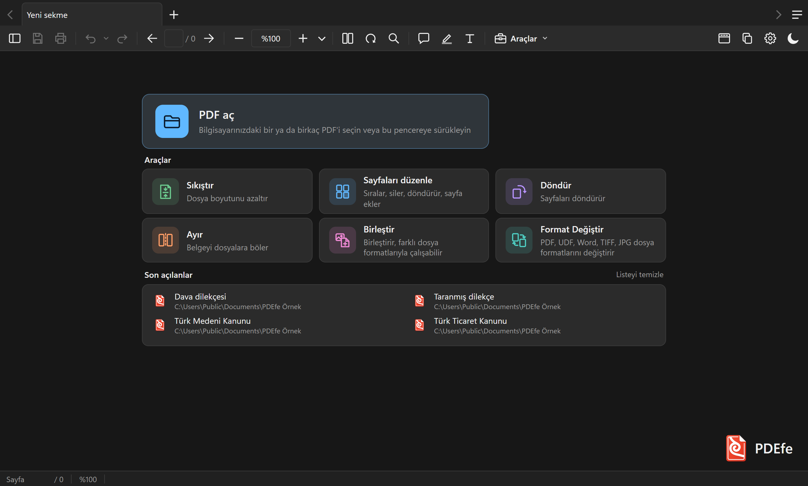

## Kurulum

### Windows

1. Yukarıdaki bağlantıdan `PDEfe-Setup.exe` dosyasını indirin ve çift tıklayın. Yönetici hakkı gerekmez.
2. Windows SmartScreen uyarı gösterirse **Daha fazla bilgi**'ye, sonra **Yine de çalıştır**'a basın. Uyarı, uygulama imzalı olmadığı için çıkar.
3. Kurulumu bitirin. Son sayfada PDEfe'yi varsayılan PDF görüntüleyici yapabilirsiniz.

### macOS

1. Yukarıdaki bağlantıdan `PDEfe-Mac.dmg` dosyasını indirin (macOS 13 ve sonrası, Apple işlemcili ve Intel Mac'ler).
2. Dosyayı açın, **PDEfe**'yi **Uygulamalar** klasörüne sürükleyin.
3. macOS ilk açılışta uyarı verirse **Sistem Ayarları › Gizlilik ve Güvenlik**'te "PDEfe engellendi" satırındaki **Yine de Aç**'a basın.

## Öne çıkanlar

- **Sekmeler ve pencereler:** Birden çok PDF tek pencerede açılır. Sekme sürüklenerek kendi penceresine ayrılır.
- **Temiz kopyalama:** Satırlar paragraf olarak birleşir, tireler kalkar. Metin UYAP Doküman Editörü'ne ve Word'e düzgün yapışır.
- **Araçlar:** Sıkıştır, Sayfaları düzenle, Döndür, Ayır, Birleştir, Format Değiştir.
- **Birleştir:** Dosyalardan tek PDF oluşturur: PDF, görüntü, TIFF, UDF ve Word dosyaları listedeki sırayla birleşir, görüntü sayfaları A4'e
  sığan en büyük ölçüde, beyaz kenar eklenmeden konur.
- **Format Değiştir:** UDF, Word, TIFF ve görüntü ↔ PDF; PDF'in her sayfası JPG olarak da kaydedilir. UDF, UYAP Doküman Editörü'nün kendi
  sayfa düzeniyle PDF olur; PDF düzenlenebilir UDF'ye çevrilir.
- **Yazdırma:** PDEfe'nin kendi penceresinde yazıcı, kâğıt, renk ve çift taraflı seçilir; sayfanın kâğıda nasıl basılacağı önceden görünür.
- **Taranmış belgede seçim:** Taranmış sayfadaki yazı da fareyle seçilip kopyalanır. Bunu bilgisayarın kendi yazı tanıyıcısı çevrim dışı yapar.
- **Arama:** Bütün açık belgelerin hepsinde birden tek tuşla arama yapılabilir.
- **Standart PDF notları:** Vurgu, not ve yazı başka PDF okuyucularında da görünür, e-imzayı bozmaz.

## Ne yapar

Ekran görüntüleri Windows'ta alındı, macOS'ta görünüm aynıdır. Bütün kısayollar uygulamada `F1` ile açılan pencerede ve Ayarlar ›
Kısayollar'da listelenir.

### Açılış ekranı

Belge açık değilken **PDF aç** düğmesi, bütün araçlar ve son açılan 10 belge görünür. PDF'ler pencereye sürüklenerek de açılır; UDF,
Word, TIFF ve görüntü dosyaları bırakılınca Format Değiştir açılır. Son açılanlar listesi istenmezse Ayarlar'dan kapatılır.

  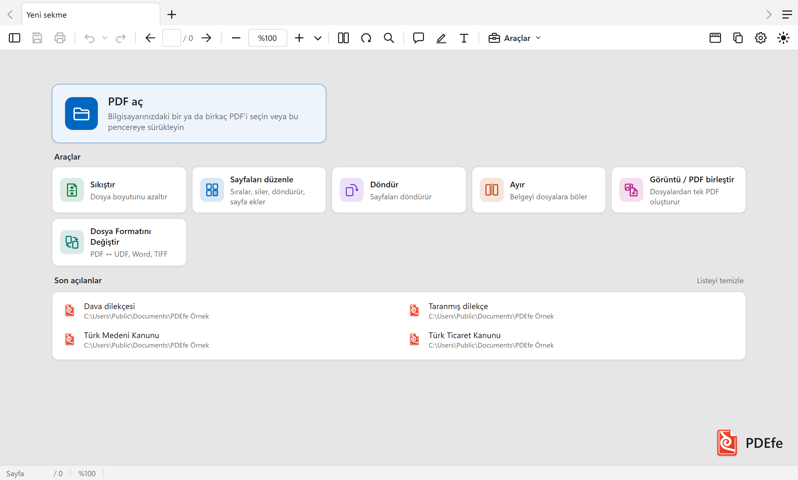

### Sekmeler ve pencereler

- **Sekmeler:** Birden çok PDF tek pencerede açılır. Sekmeler sürüklenerek sıralanır, orta tıkla kapanır. Kaydedilmemiş değişikliği olan
  sekmenin adının önünde nokta (•) durur. Sekme adında ".pdf" uzantısı yazmaz; tam ad ve yol sekmenin üstüne gelince görünür. Belge
  yeniden açılınca kalınan sayfadan devam edilir.
- **Sağ tık:** Sekmede sağ tıkla belge kaydedilir, yazdırılır, pencereye ayrılır, klasörde gösterilir ya da dosya olarak kopyalanır.
- **Pencereler:** Sekme, sekme çubuğunun dışına sürüklenince kendi penceresinde açılır. Başka bir PDEfe penceresine bırakılınca oraya
  geçer. Notlar ve geri al geçmişi sekmeyle birlikte taşınır. Boş "Yeni sekme" de ayrılır; yeni pencere açılış ekranıyla açılır. Bir araç penceresi açıkken Gezgin'den açılan belge yeni bir pencerede,
  önde açılır; araç arkadaki pencerede açık kalır.
- **Kapatma:** Birden çok sekmeli pencere kapatılırken yalnızca geçerli sekmenin mi, bütün sekmelerin mi kapanacağı sorulur. Seçim
  hatırlanabilir. Kaydedilmemiş belge varsa kaydetmek isteyip istemediğiniz sorulur.

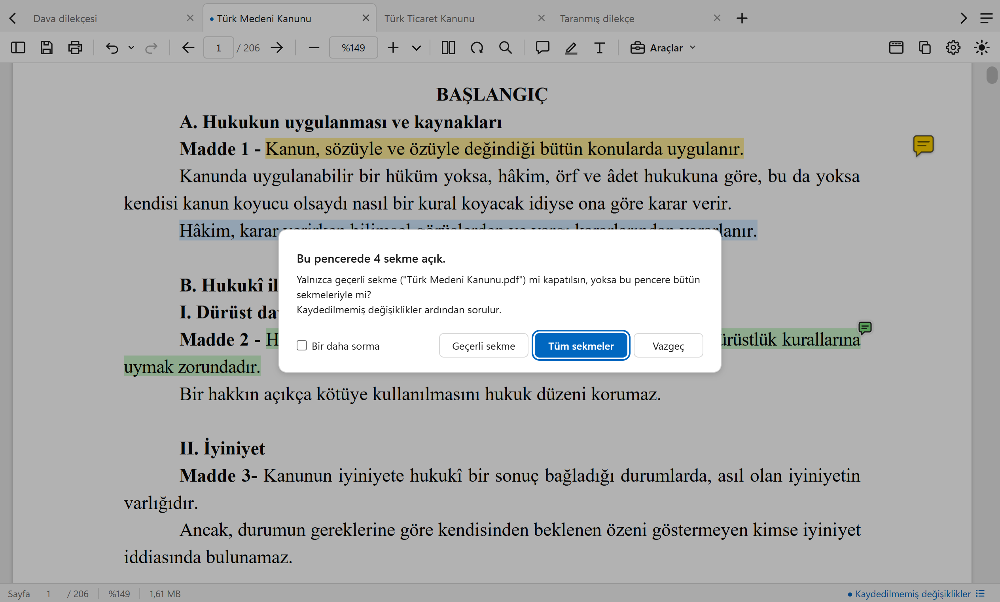

### Görünüm

- **Keskin ve akıcı:** Yazılar Windows'un ClearType çizimiyle keskin görünür. Logolu, kaşeli sayfalar bile kaydırırken ekrana net girer.
- **Düzen:** Tek ya da iki sayfa, %25 ile %6400 arası yakınlaştırma, okuma modu (`Ctrl+H`) ve tam ekran (`F11`).
- **Sol panel** (`F4`): Sayfaların küçük resimleri, İçindekiler ve Yorumlar. Panel sürüklenerek genişletilir.
- **Koyu mod:** Sistem temasını izler ya da araç çubuğundaki ay / güneş düğmesiyle değişir. İstenirse sayfa da koyulaştırılır. Bu,
  yazdırmayı ve kaydetmeyi etkilemez.

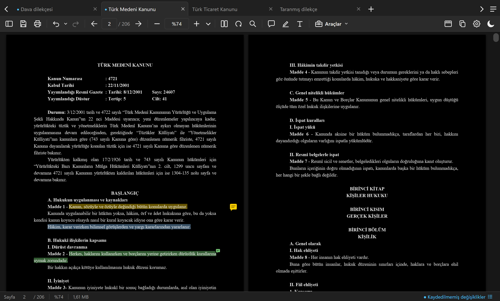

### Metin seçme ve temiz kopyalama

Metin sürüklenerek seçilir. Seçimin yanında çıkan çubukla vurgulanır, not eklenir ya da kopyalanır. Kopyalanan metinde paragrafın
satırları birleşir ve satır sonu tireleri kalkar ("hâ- / kim" → "hâkim"). Metin UYAP Doküman Editörü'ne ve Word'e fazladan boş satır
olmadan yapışır. `Ctrl+A` belgenin bütün sayfalarındaki metni seçer; `Ctrl+C` ile bütün belgenin metni aynı temizlikle kopyalanır.

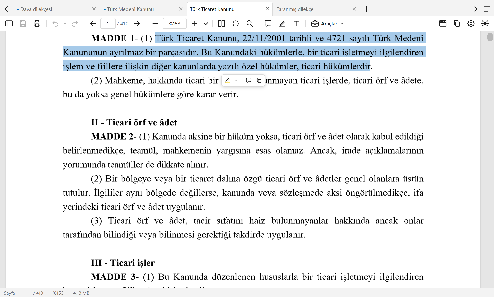

### Taranmış belgede seçim

Taranmış sayfalardaki yazı, kaşe ve antet de fareyle seçilip kopyalanır. Yazıyı Windows'un (macOS'ta Apple'ın) kendi yazı tanıyıcısı
okur. Belge hiçbir yere gönderilmez. Yan yatırılarak ya da ters taranmış sayfadaki yazı da okunur; sayfayı döndürmeniz gerekmez.
macOS 13–15'te Türkçe harfler (ş, ğ, ı, İ) yanlış gelebilir.

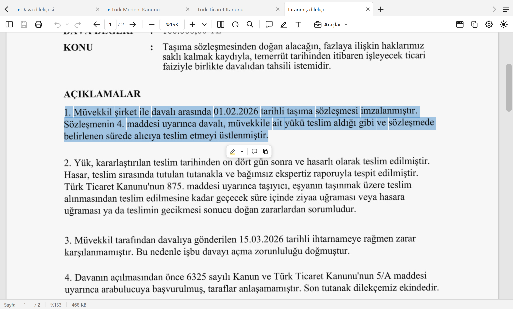

### Türkçe arama

`Ctrl+F` ile aranır. İ/ı ayrımı doğrudur, tam sözcük ve büyük-küçük harf seçenekleri vardır. **Açık belgeler** (≡) listesindeki
**Tüm belgelerde ara** kutusu her belgedeki eşleşme sayısını gösterir.

  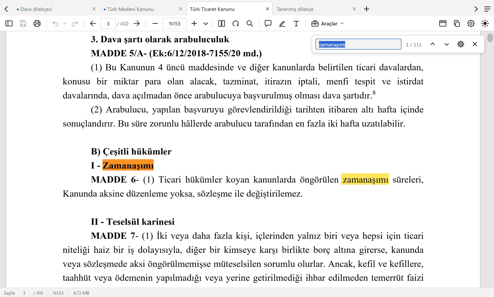

  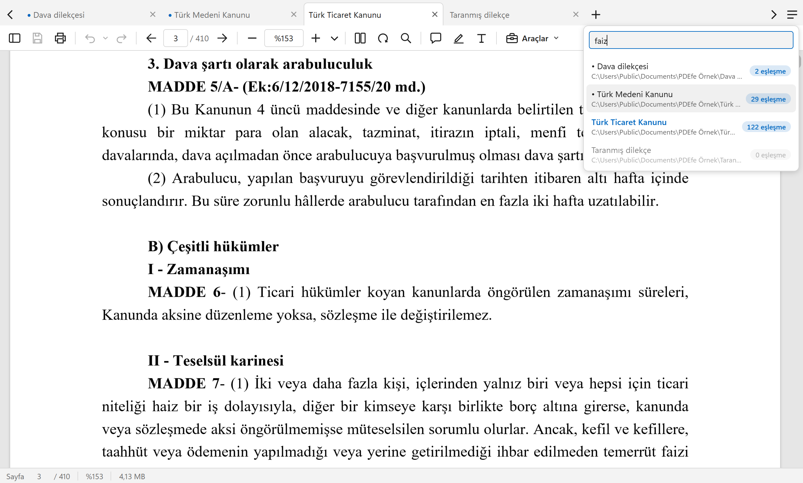

### Notlar

- **Notlar:** Altı renkte vurgu, seçili metne yorum, not ve serbest yazı eklenir. Notlar standarttır, başka PDF okuyucularında da aynı görünür.
- **Yazı kutusu:** Yazı tipi, boyut, renk, dolgu, kalın, italik ve altı çizili seçilebilir. Türkçe karakterler belgeye gömülür.
  Yazı kutusu `Ctrl+C` ile kopyalanır, `Ctrl+V` ile tıklanan yere aynı görünümle yapıştırılır; başka sekmeye ve pencereye de.
- **Kaydetme:** Notlar `Ctrl+S` ile kaydedilir. Not eklemek PDF'teki e-imzayı bozmaz.
- **Geri al:** Her işlem `Ctrl+Z` ile geri alınır. Geri al düğmesinin yanındaki ▾ listesinden birkaç adım birlikte geri alınabilir.
  Durum çubuğundaki **● Kaydedilmemiş değişiklikler** yazısı son kayıttan bu yana yapılanları listeler.

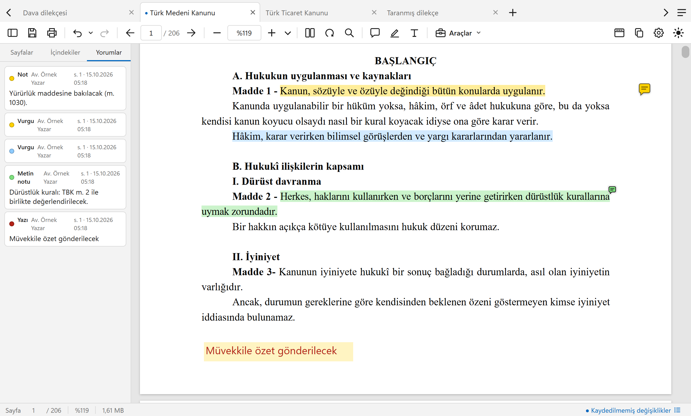

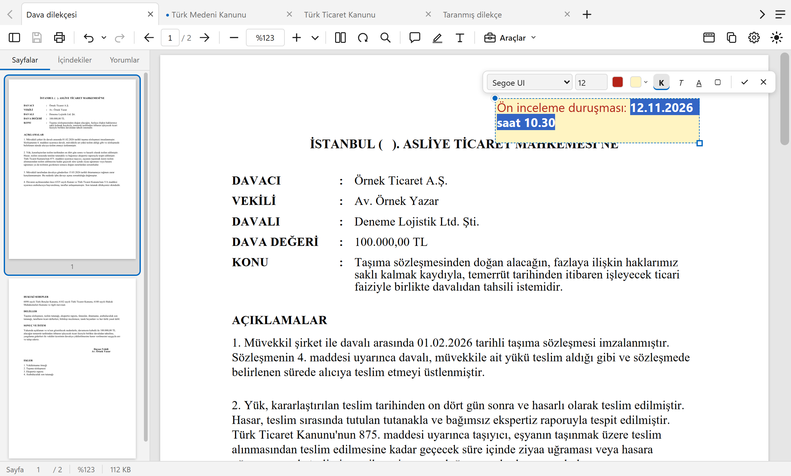

  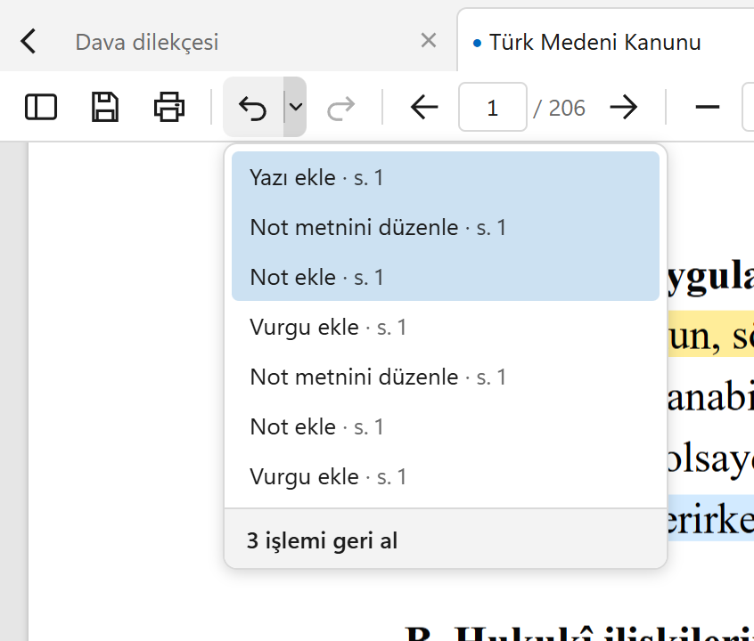
  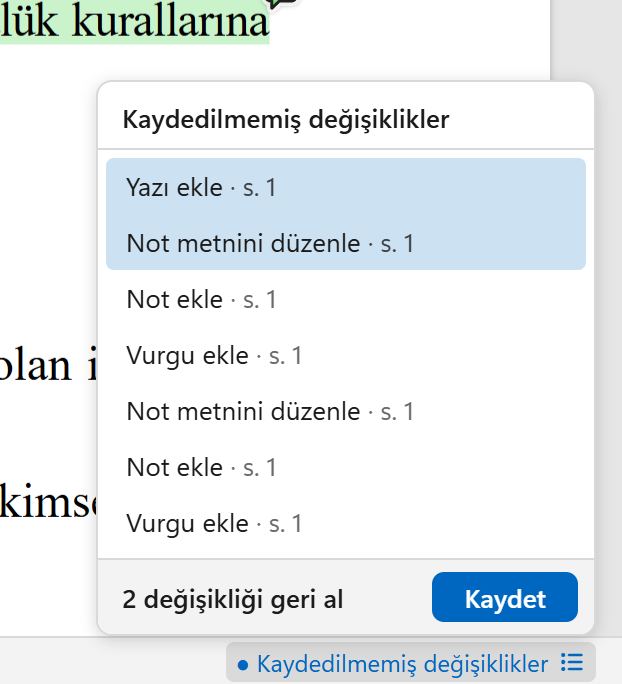

### Araçlar

Araçlar, araç çubuğundaki **Araçlar** düğmesinden ya da açılış ekranından açılır.

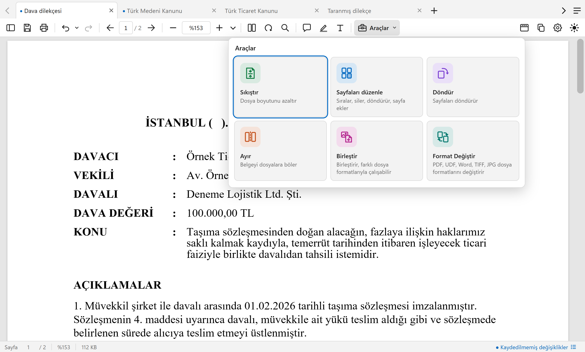

- **Sıkıştır:** Üç seviye vardır, her birinde tahminî boyut gösterilir.
- **Sayfaları düzenle:** Sayfalar büyük ön izlemelerle sürüklenerek sıralanır, silinir, döndürülür, kopyalanır. Kartın altındaki
  kopyala düğmesi sayfanın kopyasını hemen sağına ekler; `Ctrl+C` / `Ctrl+V` ve sağ tık menüsü de var. Boş sayfa ya da başka PDF'ten
  sayfa eklenir.
- **Döndür:** Tüm sayfalar, geçerli sayfa ya da bir aralık döndürülür.
- **Ayır:** Belge sayfa aralıklarına göre (örneğin `1-3, 4-10`) ya da her sayfa ayrı olacak şekilde ayrılır. Sonuçtaki **Tümünü aç**
  parçaları PDEfe'de yeni sekmelerde açar.
- **Birleştir:** PDF, görüntü (JPG, PNG, BMP, GIF, WEBP), TIFF, UDF ve Word dosyaları listedeki sırayla tek PDF'te birleşir; sonuç
  sekmede açılır. Dosyalar sürüklenerek ya da panodan eklenir. Görüntü ve TIFF sayfaları A4 boyutunda eklenir: oranı korunarak A4'e sığan
  en büyük ölçüde (dikey görüntü dikey, yatay görüntü yatay A4'ün içine), beyaz kenar eklenmeden; çözünürlükleri değişmez. Bu yüzden
  satırlarda sayfa boyutu seçimi yoktur. UDF ve Word belgeleri önce PDF'e çevrilir (aşağıda, Format Değiştir'in gereksinimleri); Word
  belgesinin sayfa sayısı ve boyutu birleştirmeden önce bilinmez.
- **Format Değiştir:** UDF, Word, TIFF ve görüntü dosyalarını PDF'e, PDF'leri bunlara ve JPG'ye dönüştürür (aşağıda).

Her araç sonucu yeni belge olarak kaydeder ya da istenirse özgün dosyanın üzerine yazar (Format Değiştir özgün dosyaya dokunmaz, her
zaman ayrı bir dosya oluşturur). Kaydedilecek ad var olan bir dosyanın adıysa sorulur: **Üzerine yaz**, **Yeni belge olarak kaydet**
(varsayılan; adına "(1)" eklenir, var olan dosya değişmez) ya da **Vazgeç**.

Kayıt klasörü bir araçta **Değiştir** ile değiştirilince bütün araçlar, yeniden değiştirilene dek o klasörü önerir (PDEfe kapatılıp açılsa
da). Klasör Ayarlar › Kaydetme › "Araçların çıktı klasörü"nde görünür, **Temizle** ile Masaüstü'ne döner. Klasör bulunamazsa (ör. takılı
olmayan bellek) Masaüstü önerilir; klasör geri gelince yine kullanılır.

  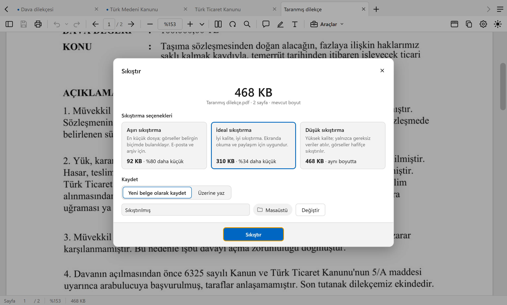

  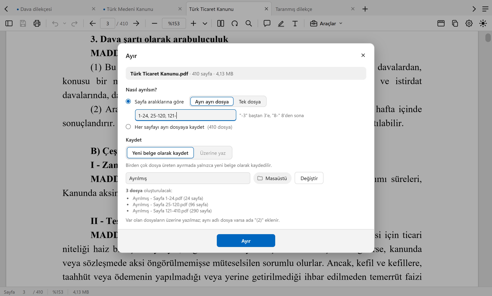

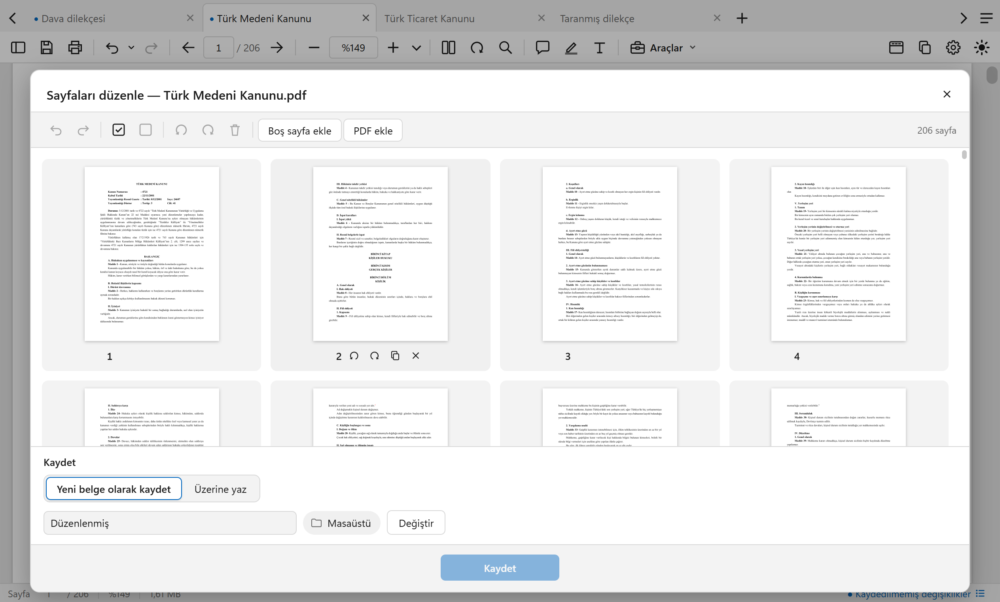

  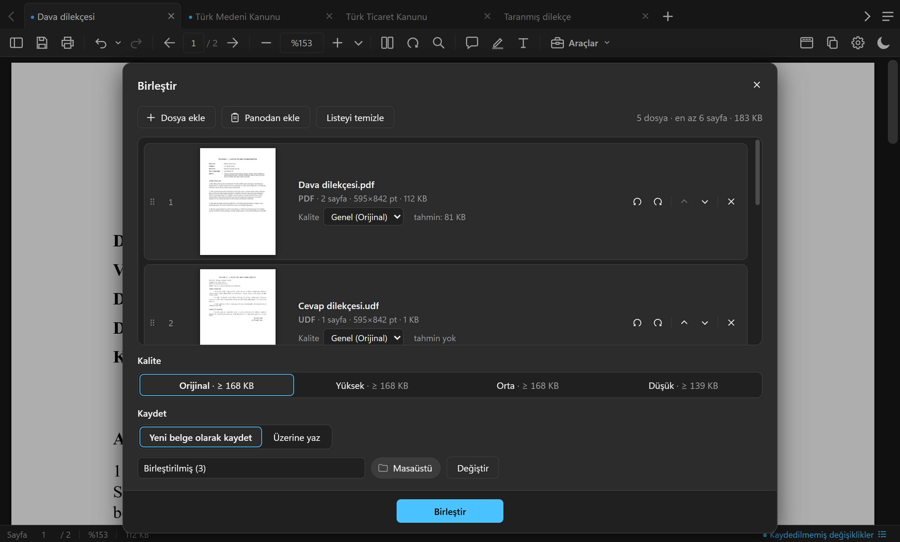

### Format Değiştir

Dosyalar **Dosya ekle** ile ya da pencereye sürüklenerek eklenir; birden çok dosya birlikte dönüştürülür. Her satırda dosyanın küçük
resmi, türü, sayfa sayısı ve hedef biçim (PDF, UDF, Word, TIFF, JPG) görünür. Bir PDF açıkken araç açılırsa o PDF listede hazırdır. UDF,
Word, TIFF ve görüntü dosyaları PDEfe'nin penceresine bırakılınca ya da `Ctrl+O` ile seçilince de araç açılır. Kalitesi düşebilecek bir
dönüştürmede (örneğin UDF → Word, TIFF → Word) hedef seçilince satırın altında kısa bir not çıkar.

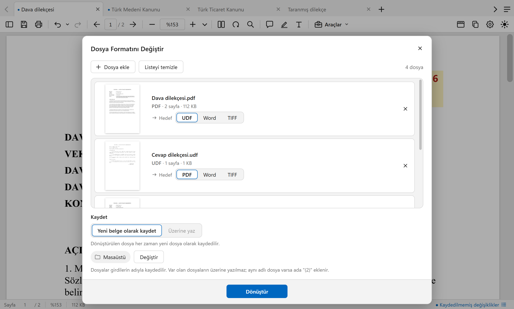

- **UDF → PDF:** UYAP Doküman Editörü'nün kendi sayfa düzeniyle, editörün penceresi açılmadan. Satırlar ve sayfalar editördeki gibi
  kırılır, sonuç editörün "Yazdır → PDF" çıktısıyla aynıdır. Sayfa her zaman A4, yazı tipleri PDF'e gömülü, antetin çevresinde gri
  çerçeve yok, sayfa numarası seçilebilir. Antet editörün yazdırmasındaki gibi çıkar. E-imza ve yorumlar PDF'e taşınmaz.
- **PDF → UDF:** Düzenlenebilir UDF. Paragraflar, kenar boşlukları, üst ve alt bilgi, antet ve çizgili tablolar alınır; sayfa numarası
  editörün kendi numarası olur. Taranmış sayfa yazı tanımayla düzenlenebilir yazıya çevrilir. Satır, sayfa düzeni ve tablolar
  kayabilir. İmza gibi yazının üstünde ya da yanında duran resimler alınmaz; sonuçta dosyanın yanındaki ⚠ simgesi bunu söyler.
  Görüntüden ve TIFF'ten yapılan UDF'nin kâğıdı A4'tür.
- **Word → PDF:** Word'ün kendisiyle; görünmeyen, ayrı bir Word kullanılır, açık Word'ünüze dokunulmaz. Belgenin yazar adı PDF'e geçmez.
  .docx, .doc, .rtf ve .odt dönüştürülür.
- **PDF → Word:** Metni düzenlenebilir .docx. Taranmış sayfalar resim olarak aktarılır. Sayfa düzeni ve tablolar birebir korunmayabilir.
- **TIFF → PDF:** Kayıpsız; her sayfa A4'e sığan en büyük ölçüde (UYAP'ın A4 taramaları tam A4) ve çoğunlukla TIFF'ten küçük.
- **PDF → TIFF:** Tek dosyada çok sayfa, siyah beyaz, gri ya da renkli.
- **Görüntü → PDF:** JPG, PNG, BMP, GIF ve WEBP. Her görüntü A4 boyutunda sayfa olur: oranı korunarak A4'e sığan en büyük ölçüde (dikey
  görüntü dikey, yatay görüntü yatay A4'ün içine; küçük görüntü büyür, büyüğü küçülür), beyaz kenar eklenmeden; çözünürlüğü değişmez.
  Telefon fotoğrafının yönü düzeltilir. iPhone'un HEIC fotoğrafları açılamaz.
- **PDF → JPG:** Her sayfa ayrı bir JPG dosyası olur ("Dilekçe - Sayfa 1.jpg", "Dilekçe - Sayfa 2.jpg"…); tek sayfalı belge "Dilekçe.jpg".
- **Çözünürlük:** TIFF ve JPG'de **İdeal** (standart, 300 dpi) ya da **Düşük** (UYAP'ın kendi taramaları gibi 200 dpi, daha küçük dosya).
  İkisinin yanında dönüştürülecek dosyaların yaklaşık boyutu yazar. Taranmış sayfalar büyütülmez.
- UDF ↔ Word, görüntü → UDF gibi PDF olmayan iki biçim arasında da dönüştürülür; PDEfe arada PDF'ten geçer.

Gereksinimler:

| Dönüştürme | Bilgisayarda gereken |
|---|---|
| UDF → PDF | UYAP Doküman Editörü ve kullandığı Java 8. Bulunamazsa UDF yine dönüştürülür, PDEfe'nin yaklaşık çizimiyle: satır ve sayfa kırılımları editördekinden farklı olabilir. Editörün yeri Ayarlar › Kaydetme'den gösterilebilir. |
| Word → PDF | Windows'ta Word ya da LibreOffice, macOS'ta LibreOffice. |
| PDF → UDF, PDF → Word, TIFF ↔ PDF, görüntü → PDF, PDF → JPG | Bir şey gerekmez. |
| Taranmış sayfanın yazısı (taranmış belgede seçim; taranmış PDF, TIFF ya da görüntü → UDF) | Windows'ta Türkçe yazı tanıyıcı (Türkçe Windows'ta hazır gelir). Türkçesi yoksa başka bir dilin tanıyıcısı kullanılır, Türkçe harfler yanlış gelebilir; hiç yoksa taranmış yazı seçilemez, UDF'de sayfa resim olarak kalır. macOS'ta bir şey gerekmez. |

Birleştir'deki UDF ve Word belgeleri için de aynı gereksinimler geçerlidir.

Dönüştürülen dosya her zaman ayrı bir dosyadır; özgün dosya değişmez. Önerilen ad klasörde varsa adına "(2)" eklenir; var olan bir
dosyanın adını kendiniz seçerseniz üzerine yazmadan önce sorulur. İptal edilirse hiçbir dosya yazılmaz.

Dönüştürmeden sonra sonuç kutusunda dosyalar listelenir. **Klasörde göster** klasörü açar; **Tümünü aç** (tek dosyada **Aç**) dosyaları
bilgisayarın kendi programıyla açar: UDF'yi UYAP Doküman Editörü, Word belgesini Word. Sağlıklı dönüştürülemediği fark edilen dosyanın
yanında ⚠ simgesi çıkar; üstüne gelince ne olduğu yazar (örneğin alınmayan resimler, yazı tanımayla çıkarılan sayfalar).

### Yazdırma ve PDF'i kopyala

- **Yazdır** (`Ctrl+P`, araç çubuğunda Kaydet'in yanındaki düğme ya da sağ tık): PDEfe'nin kendi penceresinde yazıcı, kopya ve harmanlama,
  sayfalar (tümü, geçerli sayfa, aralık), kâğıt, boyut (sayfaya sığdır, gerçek boyut), renkli ya da siyah beyaz, tek ya da çift taraflı ve
  notların basılıp basılmayacağı seçilir. Sağda sayfanın kâğıda nasıl basılacağı büyük olarak görünür. **Yazıcı tercihleri** yazıcının kendi
  ayarlarını açar. Son seçilen yazıcı, kâğıt, renk ve çift taraflı gibi seçenekler hatırlanır; sayfa seçimi her açılışta **Tümü**dür. Türkçe
  karakterler ekrandaki gibi çıkar. Microsoft Print to PDF gibi dosyaya yazan yazıcıda dosyanın kaydedileceği yer sorulur. Windows'un kendi
  yazdırma penceresini isteyenler için pencerenin altında **Windows yazdırma penceresiyle yazdır** bağlantısı var (Mac'te macOS'unki).
- **PDF'i kopyala:** Belge dosya olarak panoya kopyalanır. UYAP'a, e-postaya ya da bir klasöre `Ctrl+V` ile yapıştırılır.

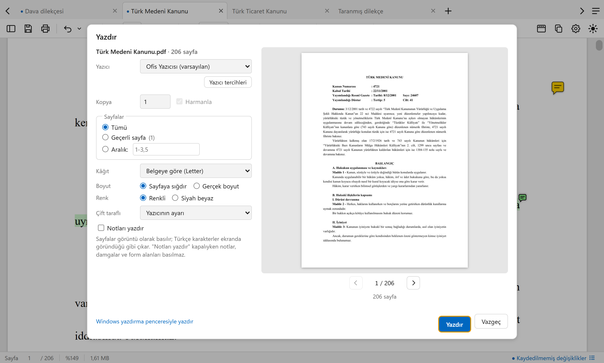

### Ayarlar

Ayarlar `Ctrl+,` ile ya da araç çubuğundaki dişliyle açılır. Tema, açılış düzeni, not renkleri, otomatik kaydetme ve güncelleme buradan
değiştirilir. PDEfe buradan varsayılan PDF görüntüleyici de yapılır. **Kaydetme** bölümünde araçların çıktı klasörü ile UYAP Doküman
Editörü'nün bulunduğu yer ve sürümü görünür; editör kendiliğinden bulunamazsa klasörü buradan seçilir.

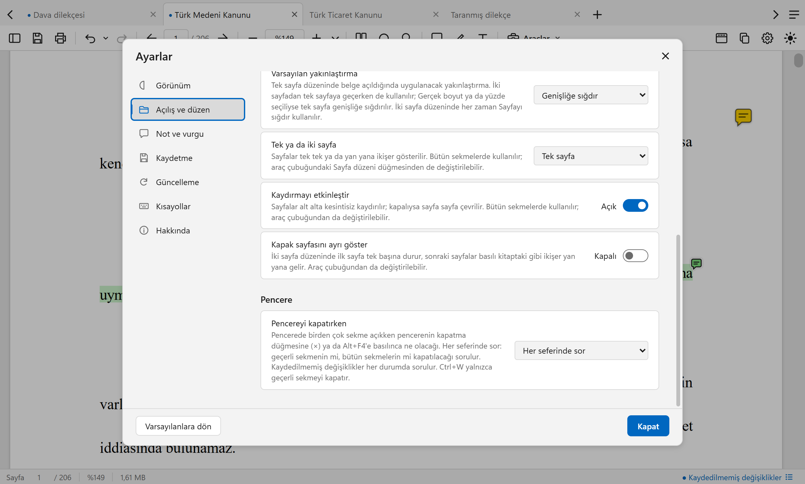

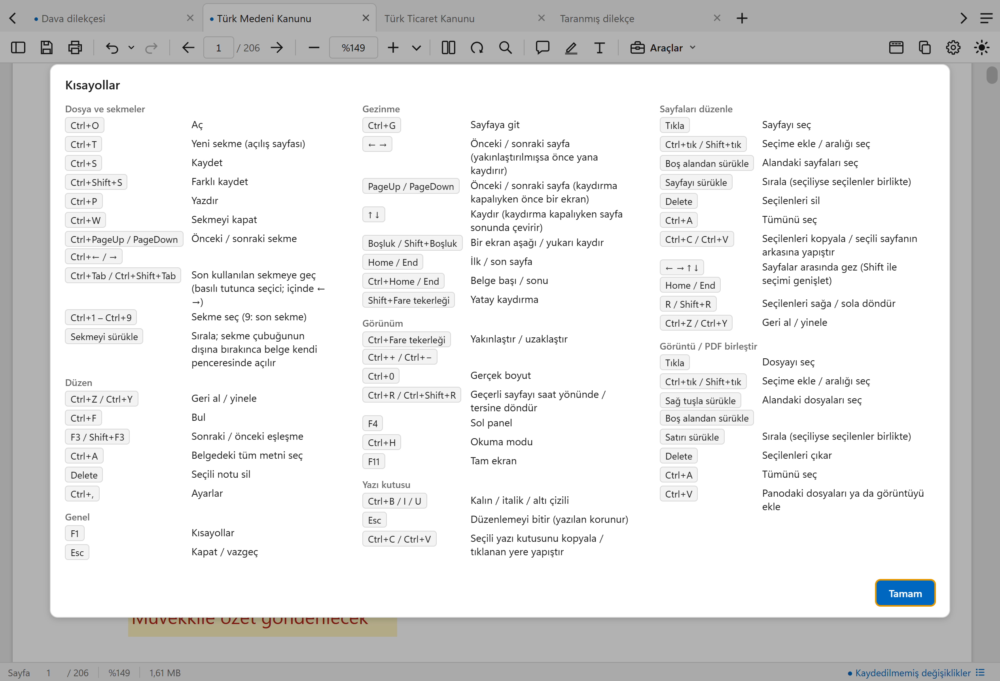

## Güncelleme

PDEfe iki günde bir yeni sürüm olup olmadığına bakar. Ayarlar › Güncelleme'deki **Şimdi denetle** ile hemen de bakılır. Yeni sürüm varsa
pencerenin üstünde şerit çıkar. Windows'ta **Güncelle**'ye basmak yeter. PDEfe yeni sürümü kurup kendiliğinden yeniden açılır. macOS'ta
**İndir** yeni dosyayı indirir, kurulumdaki gibi Uygulamalar'a sürüklenir. Sürüm notları [CHANGELOG.md](CHANGELOG.md) dosyasındadır.

İndirme bitene dek PDEfe'yi kapatmayın. Kapatırsanız ya da internet bağlantısı koparsa indirme sonraki denemede baştan başlar; şerit
PDEfe yeniden açılınca kendiliğinden yeniden çıkar. Kurulu sürümle aynı kalan kısımlar yeniden indirilmez. Kaydedilmemiş bir belgeniz
varsa PDEfe kurmadan önce sorar.

## Kaldırma

Windows'ta **Ayarlar › Uygulamalar › Yüklü uygulamalar › PDEfe › Kaldır**. macOS'ta PDEfe'yi Uygulamalar'dan Çöp Sepeti'ne sürükleyin.

## Verileriniz

Bütün işlemler bilgisayarınızda yapılır. Belgeleriniz hiçbir yere gönderilmez, telemetri yoktur. Dosya dönüştürme de bilgisayarınızda
yapılır: UYAP Doküman Editörü ve Word pencere açılmadan kullanılır, ayarlarına ve açık belgelerine dokunulmaz. Dönüştürülen belgeler Word'ün
"Son kullanılanlar" listesine eklenmez. PDEfe internete yalnızca yeni sürüm denetimi için iki günde bir GitHub'a istek gönderir. Güncelleme
denetimi Ayarlar'dan kapatılabilir (önerilmez).

## Üçüncü taraf projeler

PDEfe şu açık kaynak projeler üzerine kuruludur: Electron, PDF.js, PyMuPDF / MuPDF, Python, pdf2docx, python-docx, legaluga-uyap-ui (UDF
çizimi) ve başkaları. Sürümler ve lisanslar [THIRD_PARTY.md](THIRD_PARTY.md) dosyasındadır.

## Otomatik denetimler

\

## Teşekkür

PDEfe, açık kaynak projelerin emeği üzerine kuruldu. Sayfaları çizen PDF.js için Mozilla'ya, belgeleri işleyen MuPDF ve
PyMuPDF için Artifex'e, uygulamanın çatısı Electron'un geliştiricilerine ve adı burada geçmeyen bütün katkıcılara teşekkür ederim.

UYAP Doküman Editörü kurulu olmayan bilgisayarlarda UDF belgelerini çizen motor,
[legaluga-uyap-ui](https://github.com/hasanimer/legaluga-uyap-ui) projesinin UDF okuyucusundan türetildi (MIT lisansı; lisans metni ve telif
bildirimi `src/udf-cizim/LICENSE.txt` dosyasında). Bu emek için Hasan İmer Akın'a buradan da teşekkür ederim.

---

Soru ve geri bildirimler için: [x.com/CgrShn](https://x.com/CgrShn)

Lisans: AGPL-3.0. Ayrıntılar için [LICENSE](LICENSE) dosyasına bakınız.
